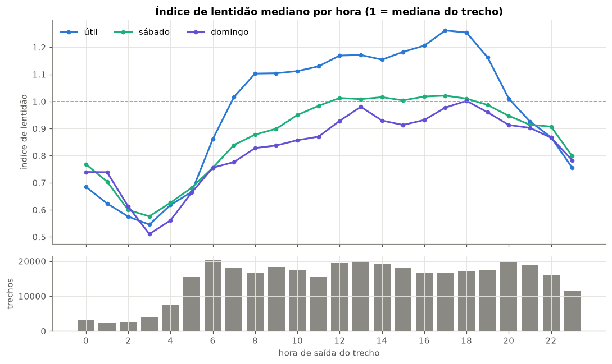
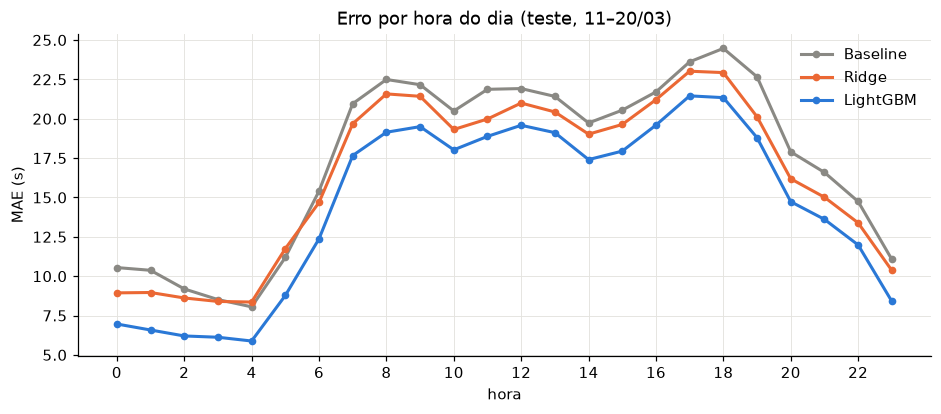

# Seções da Pessoa 1 para o relatório

Rascunho das partes da P1: Introdução, split temporal, análise temporal, Ridge e LightGBM. Os números vêm de `notebooks/01_eda_temporal.ipynb` e `notebooks/02_modelos_p1.ipynb` (linha 415). O relatório inteiro tem limite de 4 páginas, então este texto ocupa cerca de uma página e meia.

## 1. Introdução

Quem espera um ônibus no Rio de Janeiro quer saber quanto tempo ele leva até o destino. Os aplicativos respondem a isso com previsões de chegada, mas os dados abertos da cidade trazem só a posição dos veículos, sem horários de passagem nas paradas. Este trabalho constrói essa informação a partir do GPS bruto e a usa para um problema de **regressão**: prever o tempo, em segundos, que um ônibus leva entre duas paradas consecutivas.

Usamos 56 dias de GPS da linha 415 (Usina–Leblon), de 25/01 a 21/03/2019, um período que inclui o Carnaval. Somando as previsões dos trechos seguintes, chega-se ao tempo até qualquer parada adiante. Comparamos um modelo de referência (mediana histórica) com quatro modelos: Ridge, Random Forest, LightGBM e uma rede neural MLP.

## 2. Metodologia (partes da P1)

**Divisão dos dados.** A divisão é temporal e sem embaralhamento, porque o modelo seria usado para prever o futuro a partir do passado: treino até 03/03 (253.819 trechos), validação de 04 a 07/03 (19.668) e teste de 11 a 20/03 (78.918). Os dias 08 a 10/03 ficam de fora como intervalo, e 10/03 e 21/03 são descartados por falha de coleta (o GPS para às 7h e às 8h30). A validação cai na semana do Carnaval, que é atípica; ela serve para escolher hiperparâmetros, e os resultados reportados são os do teste.

**Ridge.** Regressão linear com regularização L2. Como o modelo só soma efeitos, as variáveis categóricas entram em *one-hot*: uma coluna por trecho (sentido × parada) e uma por hora × tipo de dia (útil, sábado, domingo, Carnaval). As variáveis numéricas (distância, mediana histórica do trecho, lags e ritmo da viagem) entram em logaritmo e padronizadas, e os valores ausentes recebem a mediana do treino mais uma coluna indicadora. O alvo também é previsto em logaritmo, o que torna os efeitos multiplicativos e reduz o peso da cauda longa. O `alpha` é escolhido pelo MAE na validação.

**LightGBM.** Ensemble de árvores por *boosting*, em que cada árvore corrige o erro das anteriores. Recebe as 17 variáveis sem padronização e trata os valores ausentes nativamente. Usamos a perda L1, que otimiza diretamente o MAE, e *early stopping* na validação para definir o número de árvores (598).

## 3. Resultados (partes da P1)

**Quando o ônibus atrasa.** Para comparar trechos de tamanhos diferentes, usamos o índice de lentidão: o tempo do trecho dividido pela mediana daquele trecho. Em dia útil, a lentidão sobe a partir das 6h, fica de 10% a 17% acima do normal entre 8h e 16h e atinge o pico às 17–18h (índice de 1,26). A velocidade mediana cai de cerca de 33 km/h de madrugada para 14 km/h às 17h. No pico da tarde, o dia útil é cerca de 22% mais lento que o fim de semana. No Carnaval, de segunda a quarta, os ônibus foram de 15% a 22% mais rápidos que nos mesmos dias de semanas normais, com metade da frota: o Carnaval se comporta como um domingo.

**Modelos.** A tabela traz o desempenho no teste.

| Modelo | MAE (s) | RMSE (s) | R² |
|---|---|---|---|
| Baseline (mediana por trecho, hora e fim de semana) | 19,13 | 31,49 | 0,64 |
| Ridge (one-hot, alvo em log) | 18,09 | 31,42 | 0,64 |
| LightGBM (perda L1) | **16,35** | 29,11 | **0,69** |
| LightGBM (perda L1) sem as variáveis de tempo real | 20,44 | 35,58 | 0,54 |

O LightGBM reduz o MAE em 15% em relação ao baseline. O Ridge fica 5% abaixo do baseline com o alvo em log; sem o log, empata com ele (19,04 s), com ou sem *one-hot*. O `alpha` quase não altera o resultado, o que indica que o limite do Ridge é a linearidade e não o sobreajuste: ele não representa que um trecho específico piora mais que os outros no pico.

O ganho do LightGBM vem das variáveis de trânsito em tempo real: o tempo do trecho anterior na mesma viagem, o tempo do mesmo trecho pelos ônibus anteriores e o ritmo da viagem em relação ao normal. Sem elas, o modelo fica atrás do baseline. O calendário informa o que é típico, e essas variáveis informam o que está acontecendo no dia.

O erro acompanha a curva de lentidão: é menor de madrugada (cerca de 6 s) e maior no pico da tarde (21,5 s às 17h). O LightGBM tem o menor erro em todas as horas do dia.

**Experimento extra.** Treinar um LightGBM separado para cada sentido não melhora o resultado (16,38 s contra 16,35 s do modelo único). O modelo único já recebe o sentido como variável e separa os dois trajetos sozinho.

## 4. Pontos para a Conclusão e para as limitações

- O melhor modelo da P1 é o LightGBM com perda L1, com erro médio de 16,4 s por trecho.
- A informação de trânsito em tempo real vale mais que a escolha do algoritmo.
- O erro de medição do próprio pipeline (holdout de pings) é de cerca de 25 s, da mesma ordem do erro dos modelos. Parte do erro restante é ruído de medição.
- A base não cobre a linha inteira: no Centro, quase não há trechos medidos (ver a revisão do pipeline), então a soma dos trechos ainda não dá o tempo de uma viagem completa.
